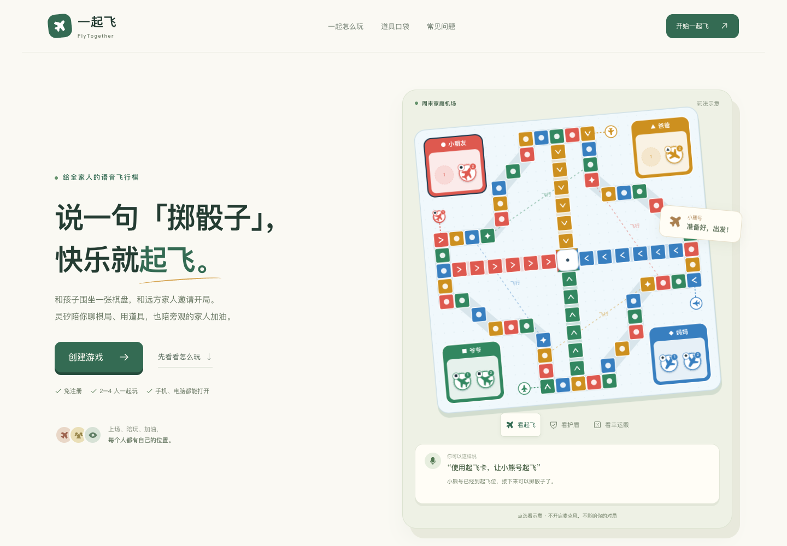

# 一起飞 · FlyTogether

[](https://github.com/zkevindev/flytogether/actions/workflows/ci.yml)
[](https://app.codecov.io/gh/zkevindev/flytogether)

**一起飞**是一款面向家庭的语音飞行棋：支持同屏和免注册联网对局，灵矽负责自然对话与讲解，Go 服务负责骰子、规则校验和棋局状态。没有语音凭据也能完整点击游玩。



产品介绍页完整截图：[桌面版](docs/images/product/product-desktop.png) · [手机版](docs/images/product/product-mobile.png) · [截图来源与版本](docs/SCREENSHOTS.md)

## 产品概览

- 2～4 席联网房间，支持真人与一位机器人混玩、掉线回位和观赛互动。
- 轻松、经典和合作玩法，三种棋盘、八种道具、任务卡、结算与再玩。
- 灵矽 Realtime 语音对话、事实播报及只读 MCP 棋局查询；语音故障时点击玩法继续可用。
- 浏览器内家庭档案与战绩、存档续玩、显示偏好、键盘操作和排障后台。

面向玩家的完整说明见 [玩法指南](docs/USER-GUIDE.md)。自动模拟、用户已确认的实机验收和仍需现场设备验证的事项分开记录，详见 [综合验收记录](docs/QA-ACCEPTANCE.md)。

## 本地启动

需要 Go 1.26+、Node.js 22.18+ 和 npm：

```sh
test -f .env || cp .env.example .env
npm --prefix web ci
npm --prefix web run build
go run ./cmd/server
```

然后打开 <http://127.0.0.1:8080/>。前端热更新、灵矽私有配置、测试与部署方式见 [开发、测试与部署](docs/DEVELOPMENT.md)。

## 文档导航

按用途浏览 [文档目录](docs/README.md)。架构、当前进展和计划可分别从以下入口开始：

- [架构设计](docs/ARCHITECTURE.md)
- [项目进展](docs/PROGRESS.md)
- [产品路线图](docs/ROADMAP.md)
- [演示与发布手册](docs/DEMO-RUNBOOK.md)

## 项目信息

- 公开仓库：[zkevindev/flytogether](https://github.com/zkevindev/flytogether)
- 贡献约定：[CONTRIBUTING.md](CONTRIBUTING.md)
- 灵矽官方文档：[linx.qiniu.com/docs](https://linx.qiniu.com/docs/)

项目不提供跨浏览器账号找回或全球排行榜。真实运营商切网、移动系统后台冻结和现场声学质量需要现场设备测试；自动模拟的范围见验收文档。
