# 一起飞 · FlyTogether

**可以同屏，也能邀请朋友各用一台设备玩的语音飞行棋。** 点击或直接说“掷骰子”“让小熊号起飞”，灵矽负责对话和解说，Go 负责随机骰子、真实走棋与胜负。

当前为 **0.1.0 可试玩版本**，更新于 **2026-10-24**。已完成公网部署与多条真实语音链路验证，正在向完整家庭产品迭代；下一阶段见 [产品化路线](docs/ROADMAP.md)。

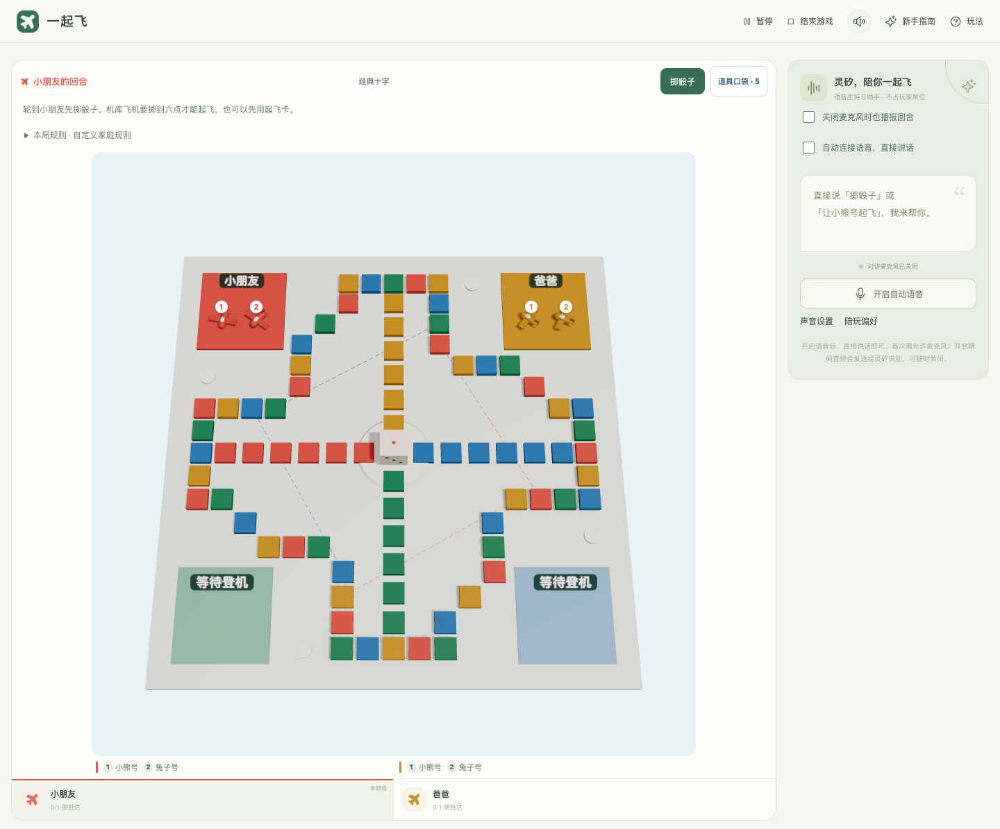

## 怎么玩

1. 首页点 **创建游戏**，设置房间名称、2～4 个总席位、玩法预设、机器人难度和棋盘。亲子轻松适合更快起飞；经典飞行采用四架全到、无道具。
2. 创建后进入独立的 **大棋盘对局页**：棋盘、玩家与语音助手常驻，道具从“道具口袋”打开。
3. 首次进入先看三步指南，引导期间保持安静；完成或跳过后再按偏好连接语音。点击掷骰，选飞机看预计落点，确认后再飞行；也可允许麦克风后直接说话，**无需唤醒词**。骰子弹窗结束后才播放走棋和起飞效果。

同屏模式返回首页会暂停，继续当前游戏保留棋局；联网模式返回首页保留席位，不暂停其他人的对局，暂停/继续/结束由房主控制。主动结束成功后返回首页，不再显示该局的继续入口；关闭对讲麦克风后，仍可选择让灵矽主动播报下一位玩家。

### 邀请朋友联网玩

创建游戏时打开 **多人联网邀请房间**，选择 2～4 个总席位（含机器人）并填写自己的昵称。可勾选 **添加机器人陪玩（占一个席位）**，最后一席会自动准备；例如两位家人加一个机器人，选择 3 席。进入准备区后点 **复制邀请链接**，发给朋友；每位朋友各用一台设备打开链接，填昵称入座并点 **我准备好了**。所有真人席位在线且准备好后，房主点 **开始游戏**。

机器人自动掷骰、走棋和按难度用卡，无需设备或麦克风；灵矽语音助手不占席位，负责主持、讲解与帮助真人操作。机器人难度与语音服务是否配置互相独立。

每个人只能为自己的席位掷骰、用卡和走棋，语音工具也受相同校验；轮到你时才连接对讲，其他回合可看棋盘、听主动播报。掉线后席位保留，**同一浏览器**返回游戏或原邀请链接即可继续；准备区客人可以退出释放空位。首版房主不转让，掉线玩家不自动托管，可由房主暂停等待。

正常获胜后，骰子、飞行和撒花完成再展示结算，统计真实掷骰、起飞、抵达、送回和用卡。**同配置再玩一局**重置统计与道具库存；联网保留原房间和席位，重新准备，不需要重发邀请。中途结束直接返回首页，不生成冠军。

在语音助手中点 **陪玩偏好**，选择温暖、教练或简洁，以及每回合、关键时刻或只问才答。偏好仅影响当前浏览器，联网各设备互不干扰；“只问才答”仍可开口操作或提问，不等于关闭麦克风。

## 当前界面

| 首页 | 创建游戏 |
| --- | --- |
| 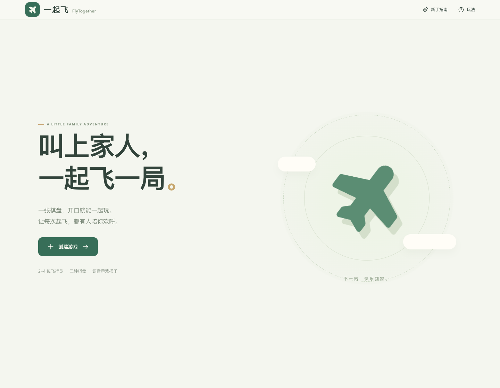 | 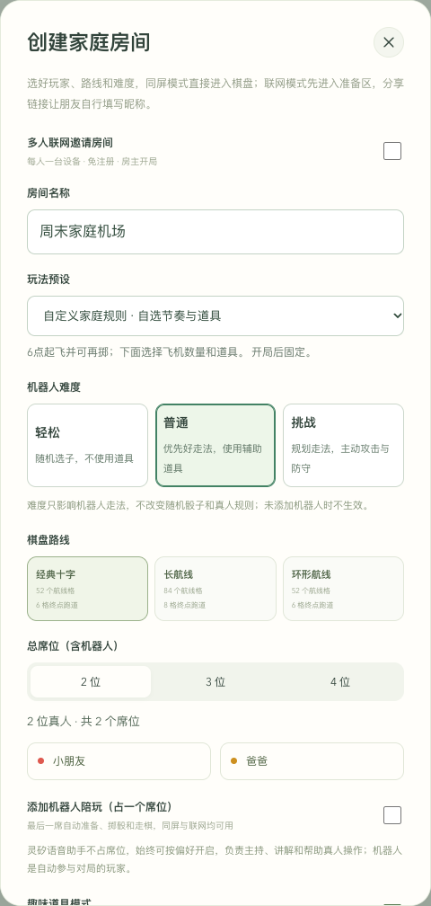 |
| 新手指南 | 选子与落点预览 |
| 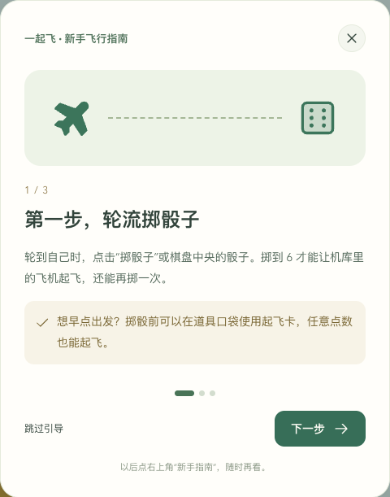 | 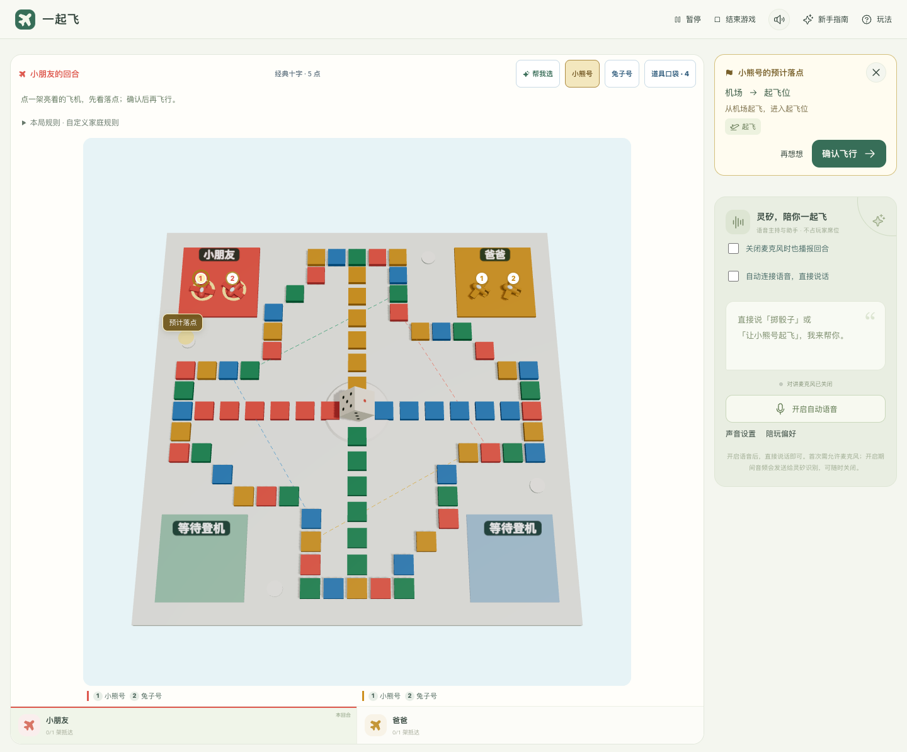 |
| 灵矽教练 | 手机建议预览 |
| 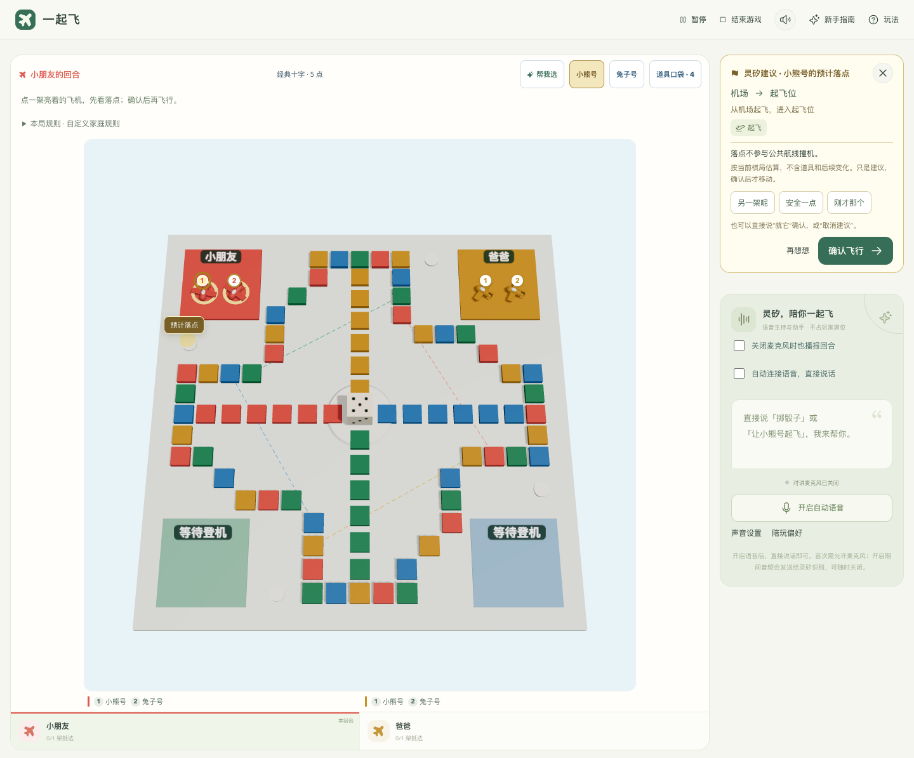 | 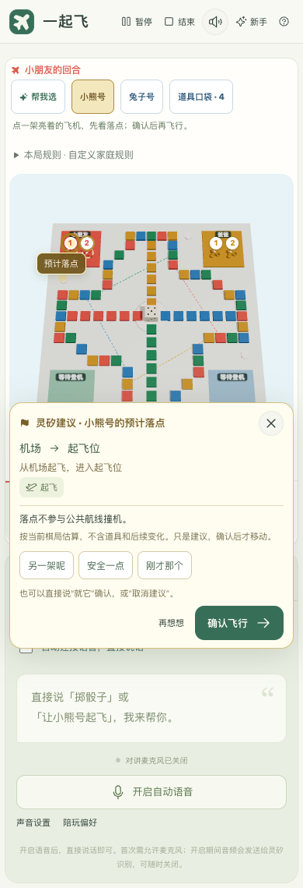 |
| 五种道具 | 3D 骰子弹窗 |
| 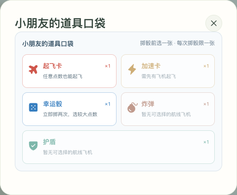 |  |

| 联网准备区 | 本局结算 |
| --- | --- |
| 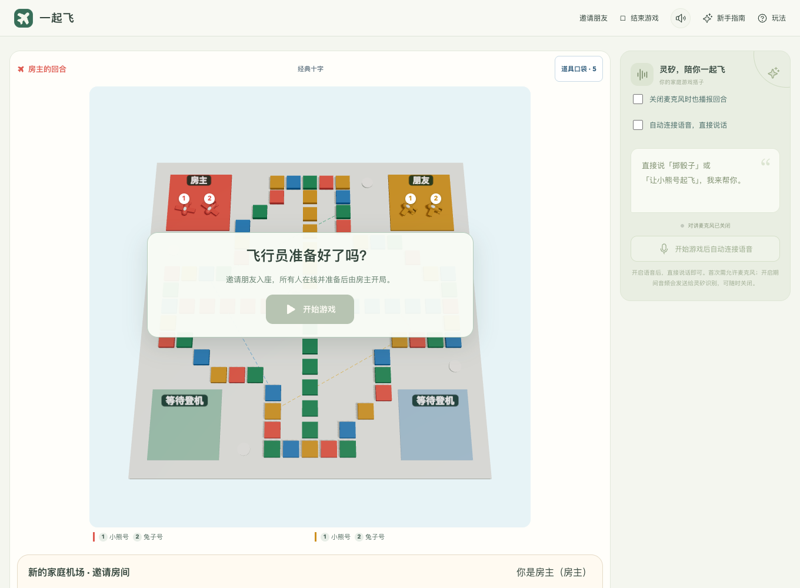 | 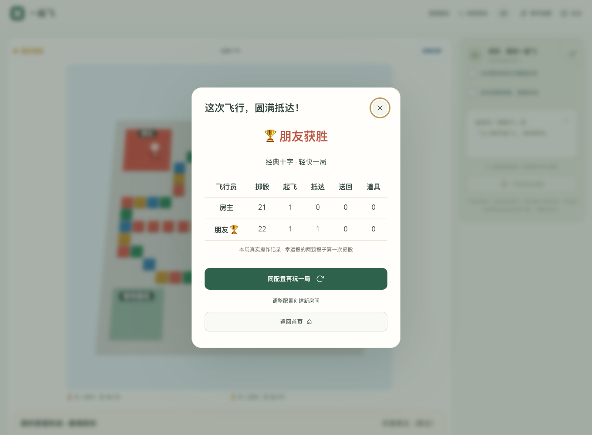 |

| 真人＋机器人 | 混合局结算 |
| --- | --- |
| 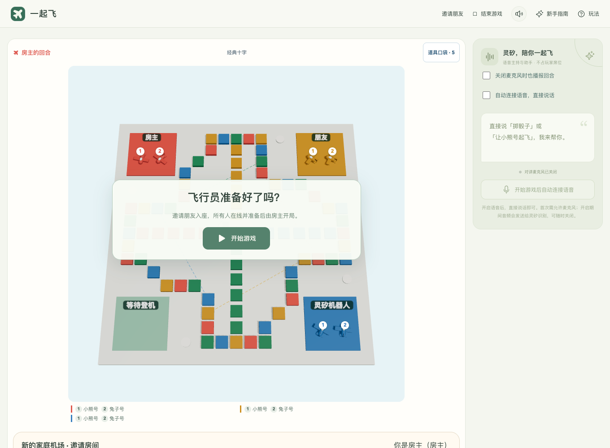 | 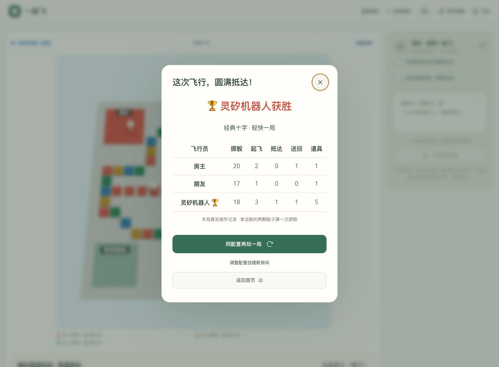 |

| 重启后续玩 | 独立声音设置 |
| --- | --- |
| 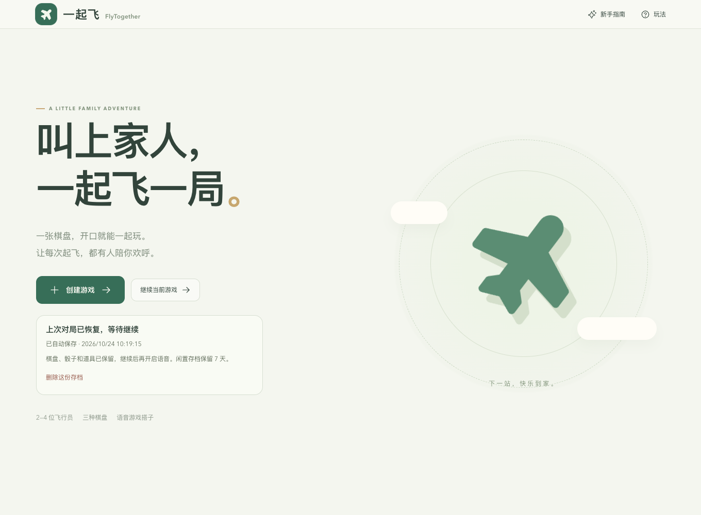 | 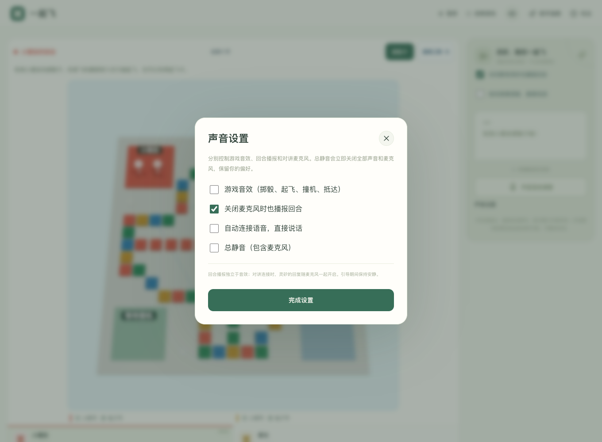 |

| 陪玩风格与频率 | 亲子辅助补给 |
| --- | --- |
| 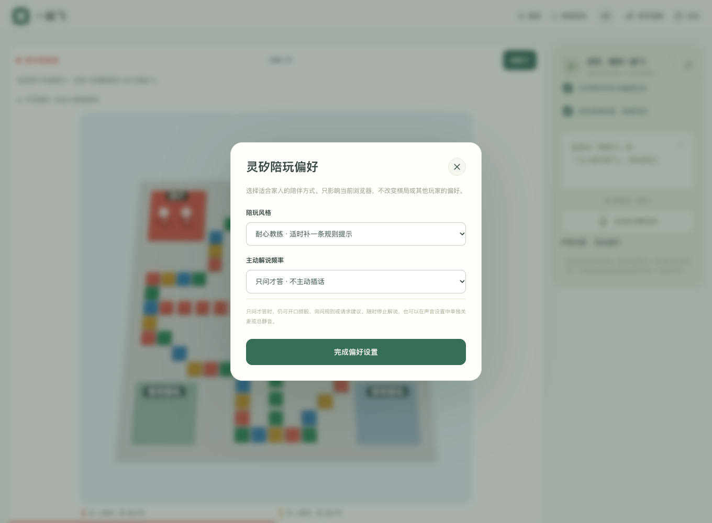 | 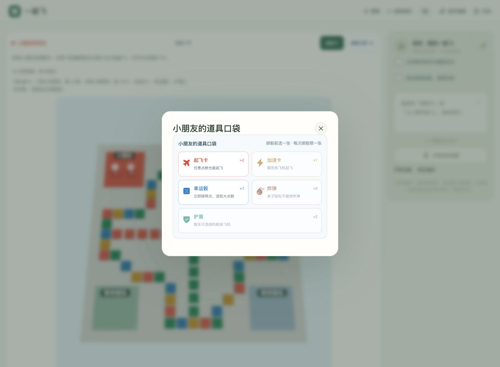 |

[查看手机对局页](docs/images/current/play-mobile.png) · [终点撒花](docs/images/finish-confetti.png) · [截图版本与复跑方式](docs/SCREENSHOTS.md)

主图及上表为 2026-10-24 从运行中的应用重新截取，非设计稿。常规界面截图关闭语音采集与自动播报；声音设置图来自受控 PCM 与 Chrome 合成麦克风回归，未使用实体录音。语音实测单独记录在 [QA-VOICE](docs/QA-VOICE.md)。

## 已有能力

| 能力 | 当前实现 |
| --- | --- |
| 联网邀请房间 | 免注册邀请、2～4 个总席位、可加一位机器人；真人准备/在线状态、房主控制、原浏览器掉线重连 |
| 存档续玩 | SQLite 自动保存，重启暂停，原浏览器恢复骰子/道具/席位；首页续玩与删除 |
| 声音控制 | 音效、回合播报、自动对讲分别保存偏好；总静音立即停播和关麦 |
| 结算再玩 | 动作级累计五项真实统计、刷新不重复、同配置再玩；联网保留席位 |
| 玩法预设 | 亲子轻松、经典飞行、原自定义规则；本局固定，点击/AI/语音一致 |
| 陪玩偏好 | 三种风格、三档主动频率，刷新保留；可跳过解说 |
| 首次加载 | 进入对局才下载3D棋盘；实测冷首页JS减少约60%，加载失败可重试 |
| 机器人陪玩 | 同屏或联网添加一位机器人，占最后一席；Go 规则策略自动行动，轻松/普通/挑战三档 |
| 三种棋盘 | 经典十字 52 格、长航线 84 格、环形航线 52 格；Three.js 棋盘、飞机编号、2D 降级 |
| 新手与预览 | 首次三步指南、跳过/重看、回合提示；预览服务端合法落点与特殊效果，确认后移动 |
| 两种节奏 | 轻快一局：每人 2 架，先到 1 架获胜；完整飞行：每人 4 架，全部抵达获胜 |
| 道具与反馈 | 起飞卡、加速卡、幸运骰、炸弹、护盾；3D 单/双骰弹窗、起飞/撞机音效、终点/胜利撒花 |
| 灵矽教练 | 掷骰后“帮我选”，同步高亮落点；另一架/安全一点/刚才那个，明确确认才飞；支持纯点击 |
| 直接语音 | 开局按偏好自动连接，支持查询、掷骰、选子、用卡、建议与打断；歧义先追问 |
| 主动回合播报 | 对讲关闭时仍可播放“轮到谁掷骰子”；由 Go 生成真实文案，灵矽合成，无需麦克风 |
| 规则一致性 | Go 校验当前局、版本、回合、道具和合法走法；同一请求去重，单句话最多一次主动写操作 |
| 运行与部署 | Go 服务托管构建后的网页；HTTPS/SSH 部署配置与凭据置于仓库之外 |

AI 难度不改变真人骰子的随机分布。语音建议不自动消耗道具，灵矽回答与动画以 Go 实际执行结果为准。

### 道具规则

自定义有道具模式每种各1张；亲子轻松为起飞卡2、加速卡1、幸运骰1、护盾2，不提供炸弹；经典飞行无道具。每次掷骰前最多用一张。

| 预设 | 起飞与加掷 | 获胜条件 |
| --- | --- | --- |
| 亲子轻松 | 5或6可起飞，只有6再掷 | 每人2架，先到1架 |
| 经典飞行 | 6起飞并再掷 | 每人4架全部抵达 |
| 自定义 | 6起飞并再掷，起飞卡允许任意点数 | 快速或完整，自选道具 |

创建页和棋盘“本局规则”展示实际规则；开局后固定，再玩保留。道具配比是初版设计，后续按试玩反馈调整。

| 道具 | 真实效果 |
| --- | --- |
| 起飞卡 | 下一次掷骰后，任意点数都能选择一架机库飞机起飞；额外回合仍要求真实六点 |
| 加速卡 | 本次在飞的飞机多走 2 格；起飞仍只到起飞位，终点仍须精确抵达 |
| 幸运骰 | 点击或说“帮我使用幸运骰”后立即由 Go 随机掷两次，取较大值；弹窗展示两次实际点数 |
| 炸弹 | 将对手公共航线上的一架指定飞机送回机场；有护盾时只抵消护盾 |
| 护盾 | 保护自己的公共航线飞机，抵挡一次炸弹或撞机 |

### 语音示例

> “使用起飞卡” → “掷骰子” → “让小熊号起飞”
>
> “帮我选” → “另一架呢” → “安全一点” → “刚才那个” → “就它”
>
> “帮我使用幸运骰。”（立即双骰投掷，无需再说掷骰子）
>
> “现在轮到谁？” “推荐一个道具。” “炸爸爸的小熊号。” “给我的小熊号加护盾。”

每句话最多执行一个操作。没有起飞卡时，亲子轻松需要真实五点或六点，经典/自定义需要六点；同名或多个候选无法明确时会追问。点数始终随机，不能通过喊某个点数控制结果。

掷骰后出现可选飞机时，可点“帮我选”或直接说。建议、比较和回看都不移动飞机；“就它”或“确认飞行”才执行当前建议。暂停、新局、其他走棋或语音断开后，旧建议不能继续确认。风险只比较当前局面下对手普通一步的撞机可能，不包含道具和后续变化，也不保证安全。

首次使用需要允许浏览器麦克风；自动播放被拦截时按页面提示点击一次解锁。麦克风开启期间音频发送给灵矽，点击“关闭对讲麦克风”会停止采集并保存偏好。暂停、结束和离开对局也会释放麦克风。

“关闭麦克风时也播报回合”使用独立的灵矽音频输出会话，不输入麦克风、不启用游戏工具；等待骰子和走棋动画完成后播放，与已连接的对话互斥。实时回复使用有界 PCM 缓冲，正常快速生成长回复不再因超过 12 秒待播而断线。

## 本地启动

需要 **Go 1.26+、Node.js 22.18+、npm**。不填灵矽密钥也可玩完整点击玩法。

```sh
# 在仓库根目录；已有 .env 时保留现有配置
test -f .env || cp .env.example .env
npm --prefix web ci
npm --prefix web run build
go run ./cmd/server
```

默认打开 <http://127.0.0.1:8080/>。Go 同时托管网页、游戏 API 和语音代理；不要通过 `file://` 直接打开 HTML。

前端开发热更新：保持 Go 服务运行，另开终端执行 `npm --prefix web run dev`，打开 Vite 输出的地址；API 与 WebSocket 会代理到本机 8080。

### 配置灵矽

在本机 `.env` 或服务器 `/etc/flytogether.env` 中设置：

```dotenv
LINGXI_REALTIME_URL=wss://xrobo-io.qiniuapi.com/v1/realtime
LINGXI_REALTIME_MODEL=lingxi-realtime
LINGXI_REALTIME_API_KEY=你的服务端API密钥
```

配置后重启 Go。密钥只由服务端读取，通过 Bearer 请求头访问灵矽，不放入网页构建产物。浏览器语音需要 localhost 或 HTTPS。

## 当前限制与下一步

- 联网支持 **真人＋一个机器人**，总席位 2～4；机器人自动行动，掉线真人不会自动变成机器人。仍没有账号/好友、房主转让、自动托管或跨浏览器身份找回。
- **SQLite 自动存档与续玩**：已确认动作落盘，重启恢复为暂停，保留骰子、道具和联网席位；用原浏览器继续，默认闲置 7 天清理。首页可查看保存时间、由房主删除；[配置与备份恢复](docs/SAVES.md)。
- 已有本局结算与同配置再玩，跨局历史战绩与家庭档案尚未实现。
- 真实平台、自动浏览器及有限真人操作/打断已验证；手机宽度截图属于响应式检查，真实亲子与实体手机验收已于 2026-10-24 由用户确认完成，记录在 [M3](https://github.com/zkevindev/flytogether/issues/3)。

陪玩风格、规则预设与按需棋盘已上线，验收和加载量口径见 [P1验收](docs/QA-P1.md)。

音效、回合播报、对讲麦克风可独立设置，顶部总静音立即停止全部音频和录音，刷新保留偏好。语音时长、并发与 UTC 日额度可通过环境变量配置，详见[存档与声音验收](docs/QA-RELIABILITY.md)。

[1.0 路线与逐项验收标准](docs/ROADMAP.md)保留尚未完成的陪玩风格、规则平衡与家庭档案。

## 验证与演示

```sh
go test -race ./...
npm --prefix web run test:board
npm --prefix web run test:presentation
npm --prefix web run test:voice
npm --prefix web run test:narration
npm --prefix web run build
```

服务启动后可运行浏览器流程：

```sh
QA_BASE_URL=http://127.0.0.1:8080 npm --prefix web run test:network:browser
QA_BASE_URL=http://127.0.0.1:8080 npm --prefix web run test:network:bot
QA_BASE_URL=http://127.0.0.1:8080 npm --prefix web run test:coach:browser
QA_BASE_URL=http://127.0.0.1:8080 npm --prefix web run test:flows:browser
QA_BASE_URL=http://127.0.0.1:8080 npm --prefix web run test:onboarding:browser
QA_BASE_URL=http://127.0.0.1:8080 npm --prefix web run test:pages:browser
QA_BASE_URL=http://127.0.0.1:8080 npm --prefix web run test:voice-buffer:browser
```

浏览器脚本需要已安装 Chrome。真实灵矽合成语音、主动播报、故障模拟、真人反馈与时延口径分别见 [语音验收](docs/QA-VOICE.md)；联网与结算见 [联机验收](docs/QA-NETWORK.md)；教练建议与确认见 [教练验收](docs/QA-COACH.md)；3D 资源、上下文恢复与降级见 [棋盘验收](docs/QA-3D.md)。截图工具与来源见 [截图说明](docs/SCREENSHOTS.md)。

## 部署

部署工具需要 **Python 3.10+ 与 Paramiko**，使用 SSH root 登录目标 Linux 服务器。复制 [部署配置示例](.env.deploy.example) 到仓库外的安全目录，填写服务器、端口、域名与凭据路径，再执行：

```sh
python3 -m venv .venv-deploy
.venv-deploy/bin/pip install paramiko
.venv-deploy/bin/python scripts/deploy.py --config /本机安全目录/flytogether-deploy.env
```

工具构建网页和 Go Linux 二进制，安装服务并检查健康；配置域名时由 Caddy 提供 HTTPS。灵矽凭据留在服务器 `/etc/flytogether.env`，权限为 `600`。仓库不保存真实服务器地址、部署域名、密钥或用户录音。

## 文档与跟踪

- [产品化路线](docs/ROADMAP.md) · [产品化 Issue #17](https://github.com/zkevindev/flytogether/issues/17)
- [存档与备份恢复](docs/SAVES.md) · [存档/声音回归](docs/QA-RELIABILITY.md)
- [架构与协议](docs/ARCHITECTURE.md) · [开发进展与提交证据](docs/PROGRESS.md)
- [贡献与文档维护](CONTRIBUTING.md) · [灵矽官方文档](https://linx.qiniu.com/docs/)
- 当前按要求直接提交 **main**；每个可验收切片回链 Issue，未创建其他分支或 PR。
