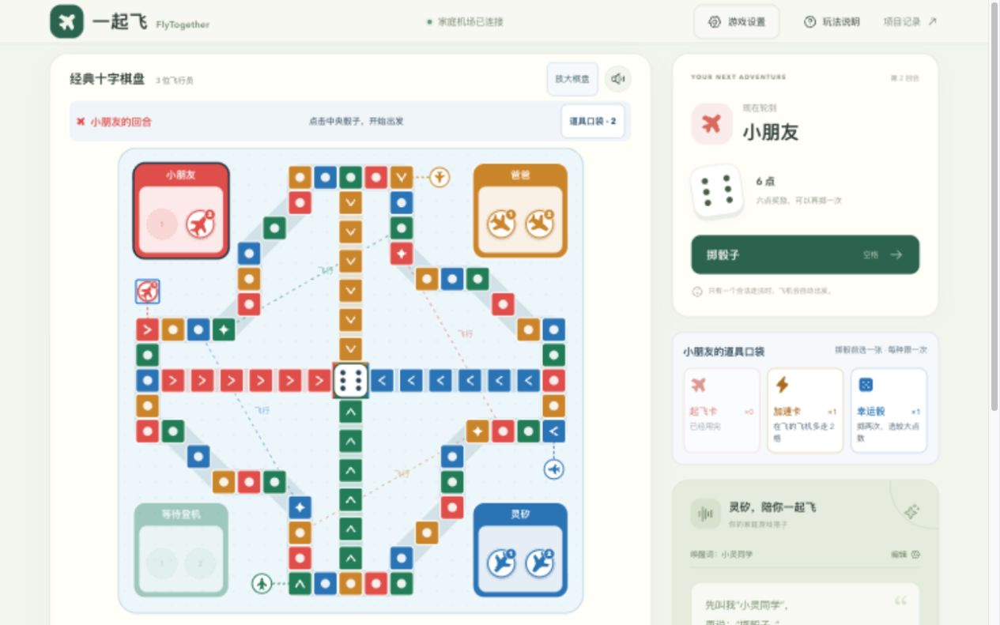

# 一起飞 · FlyTogether

**会说话的家庭飞行棋搭子。**家长和孩子围坐在同一块屏幕前，可以点击或直接开口掷骰、选飞机、询问棋局。Go 服务掌握真实棋局，灵矽负责语音对话。

公开仓库：[zkevindev/flytogether](https://github.com/zkevindev/flytogether)

## 当前状态

网页飞行棋、Go 规则服务、家庭房间、AI 对手和公开 HTTPS 部署已可用。网页通过 Go 网关连接灵矽 Realtime，提供查询棋局、掷骰和移动棋子的游戏工具。已用合成中文语音通过真实平台验证直接对话、查询、掷骰、指定飞机起飞及 PCM 音频回复；已在本机 Chrome 配合真人验证用卡、掷骰、实际起飞和语音打断；更多设备与家庭环境仍由 M3 继续验收。

棋盘可选经典十字、84 格长航线十字或环形航线；开局设置、棋盘显示和服务端路线参数保持一致。新版已部署，并完成浏览器中的开局、掷骰和合法棋子移动演示。

棋盘已按传统飞行棋布局重做：四角机场、连续彩色航线、朝向终点的跑道和中央可点击骰子，支持手机放大查看。默认启用趣味道具，也可在设置关闭，回到经典无道具玩法。



## 功能

- 创建命名的家庭同屏房间，2～4 位玩家，可邀请一名 Go 规则策略 AI。
- 三档 AI 难度；准备、开始、暂停、继续、结束和重新准备。暂停会保留棋盘并断开语音，继续时按自动语音偏好重新连接。
- 快速局和完整局，棋盘演示局面，实时同步棋局。
- 三种棋盘路线可在每局开始前选择。
- 每人各一张起飞卡、加速卡、幸运骰、炸弹和护盾，每次掷骰前最多用一张；AI 同样消耗自己的库存。
- 点击掷骰和移动，或通过浏览器实时语音操作与询问规则。
- 开始游戏后自动连接语音，直接说“掷骰子”“让小熊号起飞”，无需唤醒词和限时对话窗口。旧版唤醒偏好自动迁移。
- 到达终点撒花、被撞回机场播放坠机音效。关闭对讲麦克风后仍可通过灵矽独立播报“轮到谁掷骰子”；该播报不采集麦克风、不执行游戏工具。
- Go 服务端校验骰子、合法走法、回合和胜负；重复请求不会重复执行动作。
- 可配置部署服务器；服务器地址与凭据不写入代码仓库。

## 本地运行

需要 Go 1.26+、Node.js 22.18+。

```sh
cp .env.example .env
go run ./cmd/server
```

另开终端运行网页开发服务器：

```sh
cd web
npm ci
npm run dev
```

打开 Vite 输出的本地地址。语音使用浏览器麦克风，需要在 localhost 或 HTTPS 页面授权。

要启用灵矽语音，在本机 `.env` 或部署服务器 `/etc/flytogether.env` 设置：

```dotenv
LINGXI_REALTIME_URL=wss://xrobo-io.qiniuapi.com/v1/realtime
LINGXI_REALTIME_MODEL=lingxi-realtime
LINGXI_REALTIME_API_KEY=你的服务端API密钥
```

API Key 只由 Go 服务读取，通过 `Authorization: Bearer` 请求头访问实时接口，不会发送给浏览器。修改配置后需要重启 Go 服务。不要把真实密钥写入仓库或聊天记录。

默认开始或继续游戏后自动连接，无需先点击语音按钮或说唤醒词。首次需要允许浏览器使用麦克风；若浏览器限制声音播放，页面会提示点击一次解锁。可直接说“使用起飞卡”，接着另说“掷骰子”“让小熊号起飞”。每句话最多执行一个操作，经典起飞需要六点；起飞卡生效时可用任意点数起飞。玩家明确指定合法飞机后由 Go 实际执行并同步棋盘。点击“关闭对讲麦克风”停止监听并保存选择；勾选“自动连接语音，直接说话”可重新启用。麦克风开启期间音频发送给灵矽识别，暂停、结束和退出对局会停止采集。

“关闭麦克风时也播报回合”使用独立的灵矽输出会话，无需授权麦克风；首次可能需点击启用声音。播报在骰子和走棋动画之后进行，过期回合结果被丢弃，与已连接的实时对话互斥。当前复用 Realtime 的音频输出能力合成短句，密钥始终留在 Go 服务端。

## 房间与难度

首页点击“创建游戏”设置名称、席位、路线和道具，确认后进入独立的 `/play` 大棋盘对局页并开始游戏。对局只常驻棋盘、玩家与语音助手；道具通过棋盘上方入口打开。返回首页自动暂停，继续当前游戏时保留棋局。暂停会保留骰子、飞机和道具，阻止点击、AI 和语音操作；继续后会按自动语音偏好重新连接。结束会保留本局棋盘记录，可重新准备下一局。房间由当前浏览器会话持有，家人在同一屏幕轮流操作；跨设备邀请加入尚未实现。服务重启后内存房间会失效。

| 难度 | AI 行为 |
| --- | --- |
| 轻松 | 随机选择合法飞机，不使用道具 |
| 普通 | 按走法评分选子，使用起飞、加速和幸运骰 |
| 挑战 | 按走法评分选子，结合炸弹和护盾攻防 |

难度只影响 AI，不改变真人规则和骰子的随机分布。

## 道具怎么玩

| 道具 | 效果 |
| --- | --- |
| 起飞卡 | 下一次掷骰后，任意点数都可选一架机库飞机起飞；只有真实六点才奖励额外回合 |
| 加速卡 | 下一次掷骰后，在飞的飞机多走两格；起飞动作仍只到起飞位，终点仍须精确抵达 |
| 幸运骰 | 由 Go 随机掷两次、选较大值；网页和飞行小记显示两次点数 |

| 炸弹 | 立即将对方公共航线上的一架指定飞机送回机场；有护盾则只抵消护盾 |
| 护盾 | 保护自己公共航线上的一架指定飞机，抵挡一次炸弹或撞机；击破后飞机留在原位 |

每人开局各一张，每次掷骰只可使用一张。用完后继续正常飞行；重新开局时恢复库存。

可说“怎么办”听当前这一步。喊“我要六点”会马上掷骰，点数仍由服务随机，喊中了会告诉你。主持人说完一句后，回“好”就按那句做：只有一架能走时直接飞，有好几架时不会替你猜。说“撞爸爸”“走最前面”“回家”按意图走棋。说“推荐一个道具”获取建议；说“炸爸爸的小熊号”或“给我的小熊号加护盾”进行实际操作。建议和歧义追问不会自动用卡。掷骰后展示 CSS 3D 骰子弹窗，幸运骰同时展示两颗，结果取自服务端事件。棋盘同样由 three.js 绘制。

## 验证

```sh
go test ./...
npm --prefix web run test:board
npm --prefix web run test:voice
npm --prefix web run build
```

几何检查覆盖三种棋盘的格数、路线连续、机场不遮挡公共格和同格棋子分开显示；Go 测试覆盖道具库存、回合、真实点数与非法操作不改变棋局。真实接口的合成语音联调和浏览器演示记录见[项目进展](docs/PROGRESS.md)，直接对话、实机反馈和时延测试见[语音验收](docs/QA-VOICE.md)。

## 部署

部署脚本从仓库外的配置文件读取 SSH 地址、端口、目录、域名和凭据。复制 `.env.deploy.example` 到本机仓库之外并填写，再运行：

```sh
python3 scripts/deploy.py --config /本机安全目录/flytogether-deploy.env
```

部署后的灵矽凭据保存在服务器 `/etc/flytogether.env`，权限为仅 root 可读。详见 [部署脚本](deploy/install.sh) 与 [部署工具](scripts/deploy.py)。

## 项目记录

- [项目架构](docs/ARCHITECTURE.md)
- [开发进展](docs/PROGRESS.md)
- [贡献约定](CONTRIBUTING.md)
- [Issue #1：实时语音接入](https://github.com/zkevindev/flytogether/issues/1)
- [Issue #2：家庭飞行棋玩法](https://github.com/zkevindev/flytogether/issues/2)
- [Issue #3：试玩与比赛交付](https://github.com/zkevindev/flytogether/issues/3)
- [Issue #14：无需唤醒直接对话](https://github.com/zkevindev/flytogether/issues/14)
- [Issue #12：撒花、坠机音效与回合播报](https://github.com/zkevindev/flytogether/issues/12)
- [Issue #15：播放缓冲与连接稳定性](https://github.com/zkevindev/flytogether/issues/15)
- [Issue #5：棋盘布局重做](https://github.com/zkevindev/flytogether/issues/5)
- [Issue #6：家庭道具与语音使用](https://github.com/zkevindev/flytogether/issues/6)
- [灵矽官方文档](https://linx.qiniu.com/docs/)
