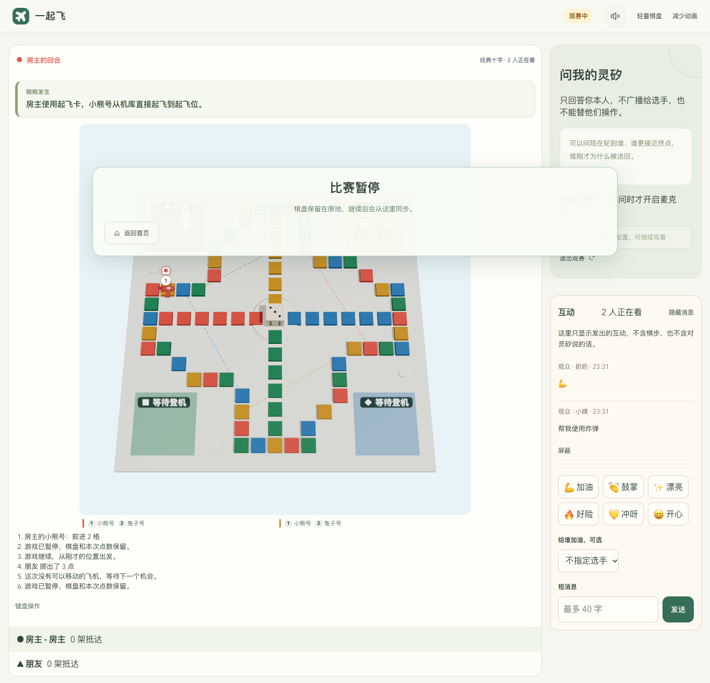
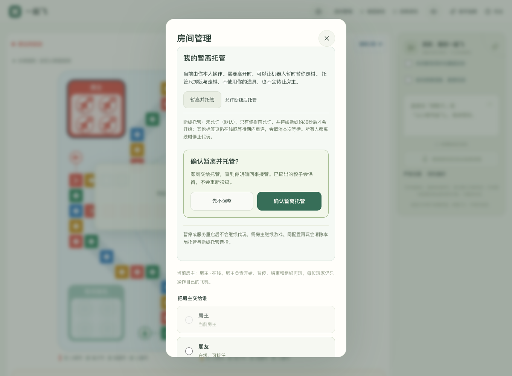
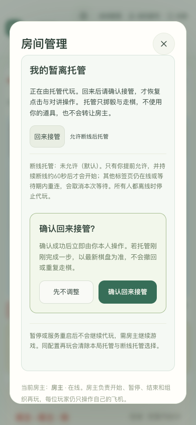
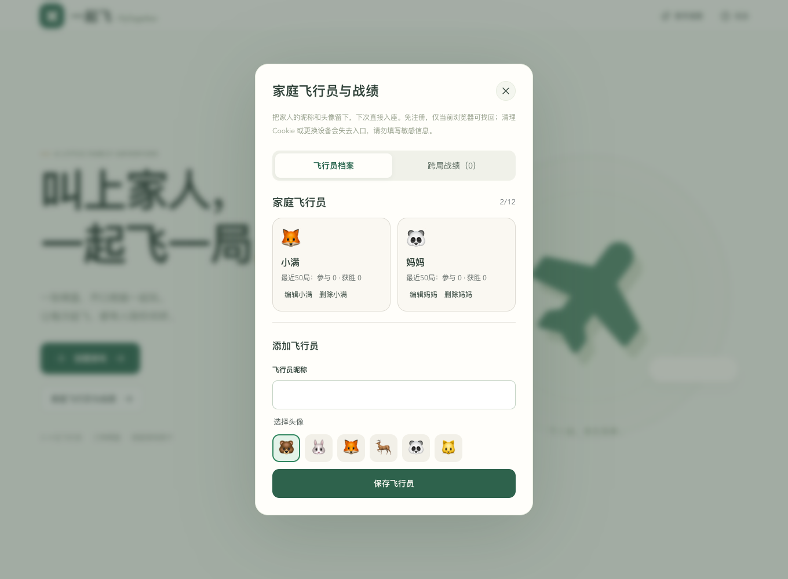
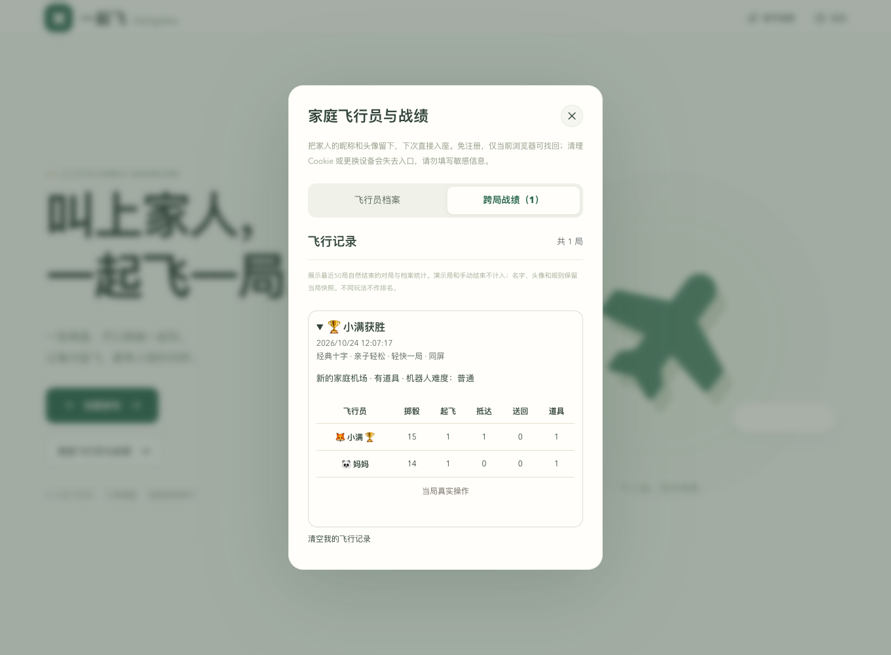
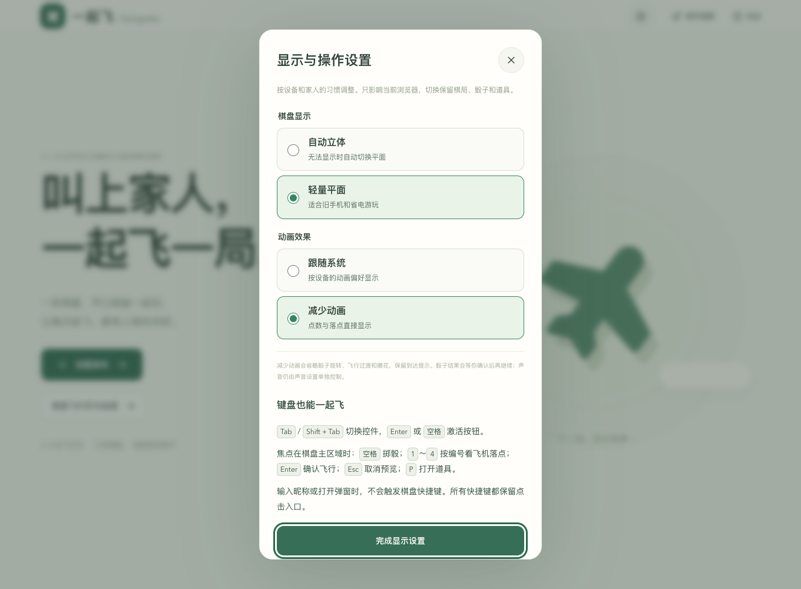
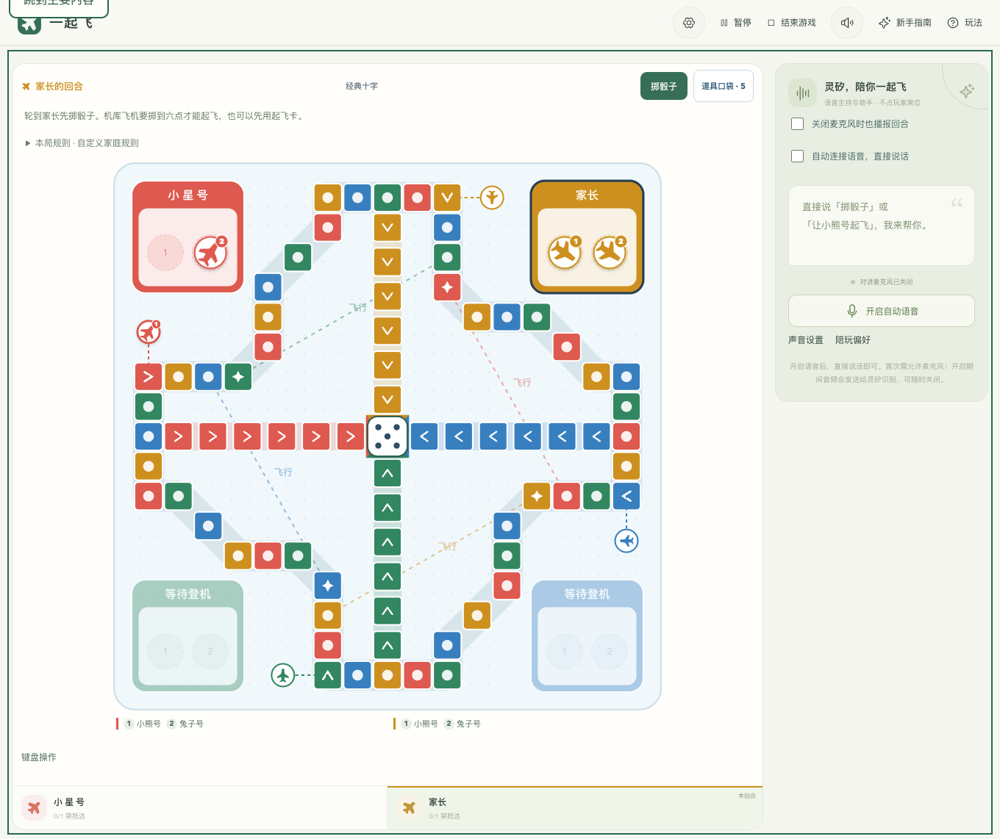
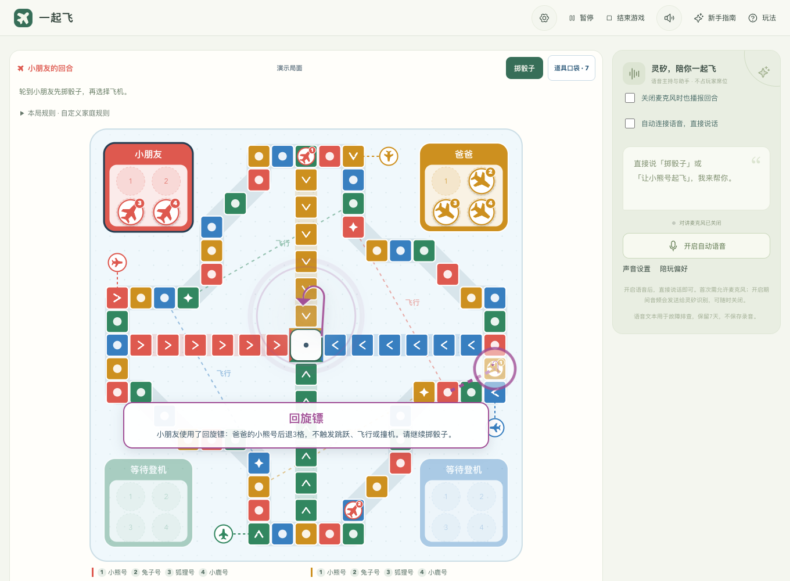
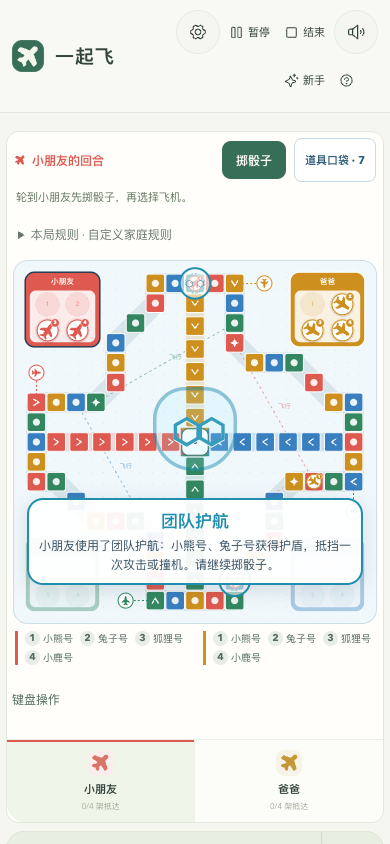

# 一起飞 · FlyTogether

[](https://github.com/zkevindev/flytogether/actions/workflows/ci.yml) [](https://app.codecov.io/gh/zkevindev/flytogether)


**可以同屏，也能邀请朋友各用一台设备玩的语音飞行棋。** 点击或直接说“掷骰子”“让小熊号起飞”，灵矽负责对话和解说，Go 负责随机骰子、真实走棋与胜负。

当前为 **0.1.0 可试玩版本**，更新于 **2026-10-24**。已完成公网部署与多条真实语音链路验证，正在向完整家庭产品迭代；下一阶段见 [产品化路线](docs/ROADMAP.md)。


## 怎么玩

1. 首页点 **创建游戏**，设置房间名称、2～4 个总席位、玩法预设、机器人难度和棋盘。可选轻快对战、四架全到的经典飞行，或全队一起完成的星河救援。
2. 创建后进入独立的 **大棋盘对局页**：棋盘、玩家与语音助手常驻，道具从“道具口袋”打开。
3. 首次进入先看三步指南，引导期间保持安静；完成或跳过后再按偏好连接语音。点击掷骰，选飞机看预计落点，确认后再飞行；也可允许麦克风后直接说话，**无需唤醒词**。骰子弹窗结束后才播放走棋和起飞效果。

同屏模式返回首页会暂停，继续当前游戏保留棋局；联网模式返回首页保留席位，不暂停其他人的对局，暂停/继续/结束由房主控制。主动结束成功后返回首页，不再显示该局的继续入口；关闭对讲麦克风后，仍可选择让灵矽主动播报下一位玩家。

### 邀请朋友联网玩

创建游戏时打开 **多人联网邀请房间**，选择 2～4 个总席位（含机器人）并填写自己的昵称。可勾选 **添加机器人陪玩（占一个席位）**，最后一席会自动准备；例如两位家人加一个机器人，选择 3 席。进入准备区后点 **复制邀请链接**，发给朋友；每位朋友各用一台设备打开链接，填昵称入座并点 **我准备好了**。所有真人席位在线且准备好后，房主点 **开始游戏**。

机器人自动掷骰、走棋和按难度用卡，无需设备或麦克风；灵矽语音助手不占席位，负责主持、讲解与帮助真人操作。机器人难度与语音服务是否配置互相独立。

每个人只能为自己的席位掷骰、用卡和走棋，语音工具也受相同校验；轮到你时才连接对讲，其他回合可看棋盘、听主动播报。掉线后席位保留，**同一浏览器**返回游戏或原邀请链接即可继续；准备区客人可以退出释放空位。房主可在“房间管理”转让给在线真人；房主持续离线60秒后，在线成员可确认接任。原房主重连保留原席位，管理权按新房主执行。掉线默认等待本人；只有玩家提前允许断线托管，持续断线经过等待期后才会代玩。

### 先了解一起飞

`/product` 是独立产品介绍页，说明同屏、联网、观赛和灵犀陪玩。可以点看起飞/护盾/幸运骰示意、比较两种节奏，并直接打开创建设置；浏览时不会创建对局、开麦或加载3D。


### 邀请家人观赛

联网房间的房主可以在准备区打开 **家人观赛**，复制独立的观赛链接。朋友填写昵称后进入观赛页，能看到棋盘、回合、点数和最近棋步，**不占 2～4 个比赛席位**，也不参与准备。已经入座的选手打开观赛链接不会失去原席位。

观众默认安静观看。点 **开始提问** 后，只和自己的灵犀对话，可以询问谁领先、轮到谁或刚才发生了什么；这句话不会替选手掷骰、走棋或用卡，回复也不会播给其他人。房主可以关闭观赛或禁止观众发言。观众和选手还能发送加油、鼓掌等表情和最多 40 字的短消息，可以屏蔽某个人；这些消息不会自动朗读，也不会变成比赛指令。

观赛身份保存在当前浏览器。刷新可以回来，点退出只离开自己。房主更新链接后，旧链接不能再加入，已经在看的人不受影响。同配置再玩会清空互动消息，并断开观赛助手，需要重新提问。观众人数和加入频率由 `SPECTATOR_CAPACITY`、`SPECTATOR_JOINS_PER_MINUTE` 配置。观赛助手使用单独的连接数、会话时长 `SPECTATOR_SESSION_SECONDS` 和每日额度，不占用选手对讲名额。

当前回合、飞机进度与最近棋步使用服务端事实解说；重连直接跟上最新棋盘。

[观赛验收](docs/QA-AUDIENCE.md)。



[手机观赛页面](docs/images/audience/watch-mobile.png) · [独立灵犀问答](docs/images/audience/watch-private-voice.png)

正常获胜后，骰子、飞行和撒花完成再展示结算，统计真实掷骰、起飞、抵达、送回和用卡。**同配置再玩一局**重置统计与道具库存；联网保留原房间和席位，重新准备，不需要重发邀请。中途结束直接返回首页，不生成冠军。

在语音助手中点 **陪玩偏好**，选择温暖、教练或简洁，以及每回合、关键时刻或只问才答。偏好仅影响当前浏览器，联网各设备互不干扰；“只问才答”仍可开口操作或提问，不等于关闭麦克风。

### 暂离托管与回来接管

联网对局打开 **房间管理 → 我的暂离托管**，点 **暂离并托管**并确认。机器人会为你的原席位掷骰与走棋，**不使用道具**，所有人都能看到托管标记和实际动作。已投掷的点数保留，选子阶段不会重新投掷。

回来后点 **回来接管**并确认，成功后立即恢复本人点击和对讲；托管若刚完成一步，就从最新棋盘继续，不撤回或重复走棋。房主仍保留房间管理权。

**断线托管默认关闭。** 本人可以提前明确允许本局断线托管；持续断线约60秒后，且仍有真人在房间时才会开始。等待期内重连或另一标签页仍在线，会取消等待。断线托管启动后，重连仍需明确接管。关闭未来断线托管不会自动结束当前托管。

所有真人离线时停止真人托管；暂停或服务重启后保留状态且不代玩，房主继续后再推进。同配置再玩清除本局托管及断线托管选择。仍需原浏览器Cookie回到原席位，尚不支持换设备找回。等待期由服务端`ROOM_DELEGATION_SECONDS`配置（默认60，5～600秒）。

[托管与回位验收](docs/QA-DELEGATION.md)。

| 暂离确认 | 手机回来接管 |
| --- | --- |
|  |  |

### 保存家庭飞行员与战绩

首页打开 **家庭飞行员与战绩**，保存昵称和六种内置头像，最多12位。创建同屏房间时可分别选档案；联网房主和朋友只选择自己设备里的档案，临时昵称仍可游玩。修改昵称后新建游戏使用新名字；当前局与同配置再玩保留原配置，旧战绩保留当时的名字和头像。

自然获胜后由 Go 同时保存棋局和真实战绩，可查看最近50局、档案在这50局中的参与/获胜数及每局五项操作。演示和手动结束不计入。支持删除档案或单独清空记录；删除存档不会删除历史，清空只影响当前浏览器。档案按浏览器 Cookie 找回，访问时续期一年，清理 Cookie 或换设备无法找回；房间闲置7天保留期不变。

### 管理排障与自动测试

游戏同域名的 `/admin` 提供独立密钥登录的只读后台，可查询每局快照、真实棋步、语音转写/助手回复、工具结果和浏览器语音故障；支持房间搜索、分页和事件筛选。重开保留上一局，默认保留7天，不保存录音；启用前的对话不能补回。[配置与使用](docs/ADMIN.md) · [实际验收](docs/QA-ADMIN.md)。

每次main推送自动运行Go vet/race与覆盖率、现有前端测试及构建。顶部Codecov徽章链接到文件级Go覆盖率；Actions另保留HTML/原始报告。当前未收集前端行覆盖率，Go比例不代表整个产品。[CI与报告说明](docs/CI.md)。

### 按设备调整显示与操作

右上角 **显示与操作设置** 可以切换自动立体/轻量平面、跟随系统/减少动画，当前浏览器保存，切换保留对局。轻量棋盘跳过立体模块；减少动画时直接显示骰子结果，键盘游玩时按“继续飞行”或 Enter 继续，点击和语音保留自动继续。

可用 Tab 导航、Enter/空格激活控件。焦点在棋盘主区域时：空格掷骰，1～4 按编号看落点，Enter确认、Esc取消，P打开道具；输入昵称和打开弹窗时不会触发棋盘快捷键。头部的“跳到主要内容”可跳过导航。

## 当前界面

| 首页 | 创建游戏 |
| --- | --- |
|  |  |
| 新手指南 | 选子与落点预览 |
|  |  |
| 灵矽教练 | 手机建议预览 |
|  |  |
| 八种道具 | 3D 骰子弹窗 |
|  |  |

| 联网准备区 | 本局结算 |
| --- | --- |
|  |  |

| 真人＋机器人 | 混合局结算 |
| --- | --- |
|  |  |

| 重启后续玩 | 独立声音设置 |
| --- | --- |
|  |  |

| 陪玩风格与频率 | 亲子辅助补给 |
| --- | --- |
|  |  |

| 家庭飞行员 | 跨局战绩 |
| --- | --- |
|  |  |

| 显示与操作设置 | 轻量棋盘 |
| --- | --- |
|  |  |

[查看手机对局页](docs/images/current/play-mobile.png) · [终点撒花](docs/images/finish-confetti.png) · [截图版本与复跑方式](docs/SCREENSHOTS.md)

主图及上表为 2026-10-24 从运行中的应用重新截取，非设计稿。常规界面截图关闭语音采集与自动播报；声音设置图来自受控 PCM 与 Chrome 合成麦克风回归，未使用实体录音。语音实测单独记录在 [QA-VOICE](docs/QA-VOICE.md)。

## 已有能力

| 能力 | 当前实现 |
| --- | --- |
| 联网邀请房间 | 免注册邀请、2～4 个总席位、可加一位机器人；真人准备/在线状态、房主控制、原浏览器掉线重连 |
| 观赛与互动 | 独立观赛链接和只读棋盘；每位观众自己的灵犀只读问答；表情/短文字，不占席位、不执行比赛指令 |
| 存档续玩 | SQLite 自动保存，重启暂停，原浏览器恢复骰子/道具/席位；首页续玩与删除 |
| 家庭档案与历史 | 本浏览器12位昵称/头像，选人复用；自然结算事务保存，最近50局、真实五项统计和独立清空 |
| 声音控制 | 音效、回合播报、自动对讲分别保存偏好；总静音立即停播和关麦 |
| 结算再玩 | 动作级累计五项真实统计、刷新不重复、同配置再玩；联网保留席位 |
| 玩法预设 | 亲子轻松、经典飞行、原自定义规则；本局固定，点击/AI/语音一致 |
| 陪玩偏好 | 三种风格、三档主动频率，刷新保留；可跳过解说 |
| 显示与键盘 | 自动立体/轻量平面、系统/减少动画；焦点恢复、键盘主流程和关键44px触控入口 |
| 首次加载 | 进入对局才下载棋盘，轻量跳过立体模块；设置按需加载，模块失败可转轻量 |
| 机器人陪玩 | 同屏或联网添加一位机器人，占最后一席；Go 规则策略自动行动，轻松/普通/挑战三档 |
| 三种棋盘 | 经典十字 52 格、长航线 84 格、环形航线 52 格；Three.js 棋盘、飞机编号、2D 降级 |
| 新手与预览 | 首次三步指南、跳过/重看、回合提示；预览服务端合法落点与特殊效果，确认后移动 |
| 三种玩法 | 轻快一局：每人 2 架，先到 1 架获胜；完整飞行：每人 4 架，全部抵达获胜；星河救援：2～4 人各送达 1 架后全队获胜 |
| 道具与反馈 | 起飞卡、加速卡、幸运骰、炸弹、护盾、回旋镖、救援卡、团队护航；使用/命中/护盾抵挡特效与独立音效；3D 单/双骰弹窗、起飞/撞机音效、终点/胜利撒花 |
| 灵矽教练 | 掷骰后“帮我选”，同步高亮落点；另一架/安全一点/刚才那个，明确确认才飞；支持纯点击 |
| 直接语音 | 开局按偏好自动连接，支持查询、掷骰、选子、用卡、建议与打断；歧义先追问 |
| 主动回合播报 | 对讲关闭时仍可播放“轮到谁掷骰子”；由 Go 生成真实文案，灵矽合成，无需麦克风 |
| 规则一致性 | Go 校验当前局、版本、回合、道具和合法走法；同一请求去重，单句话最多一次主动写操作 |
| 运行与部署 | Go 服务托管构建后的网页；HTTPS/SSH 部署配置与凭据置于仓库之外 |

语音掷骰先执行Go，再确认真实结果并驱动骰子动画；含糊说法会澄清，掷骰问句/否定不执行。等待选飞机时不能再次掷骰。

AI 难度不改变真人骰子的随机分布。语音建议不自动消耗道具，灵矽回答与动画以 Go 实际执行结果为准。

[八种道具与语音验收](docs/QA-PROPS.md) · [原生Realtime MCP接入核对](docs/LINGXI-MCP.md)


| 回旋镖命中 | 团队护航（减少动画） |
| --- | --- |
|  |  |

### 道具规则

新建自定义有道具局八种各1张；亲子轻松为起飞卡2、加速卡1、幸运骰1、护盾2、救援卡1、团队护航1，无炸弹和回旋镖；经典飞行无道具。每次掷骰前最多使用一张道具；起飞卡立即将选中的飞机送到起飞位，并占用本次掷骰的道具位。旧存档不会补发新道具，创建新局或同配置再玩可获得新补给。

| 预设 | 起飞与加掷 | 获胜条件 |
| --- | --- | --- |
| 亲子轻松 | 5或6可起飞，只有6再掷 | 每人2架，先到1架 |
| 经典飞行 | 6起飞并再掷 | 每人4架全部抵达 |
| 自定义 | 6起飞并再掷；起飞卡选一架机库飞机直接送到起飞位 | 快速或完整，自选道具 |
| 星河救援 | 每人2架，6起飞并再掷；可选自定义道具 | 每位飞行员各抵达1架后，全队共同获胜 |

创建页和棋盘“本局规则”展示实际规则；开局后固定，再玩保留。道具配比是初版设计，后续按[试玩与平衡记录](docs/PLAYTEST-BALANCE.md)收集多局反馈后再调整；暂不凭单局结果改配比。

| 道具 | 真实效果 |
| --- | --- |
| 起飞卡 | 选择一架机库飞机后立即送到起飞位，不用掷骰；后续掷出六点才可再掷 |
| 加速卡 | 本次在飞的飞机多走 2 格；起飞仍只到起飞位，终点仍须精确抵达 |
| 幸运骰 | 点击或说“帮我使用幸运骰”后立即由 Go 随机掷两次，取较大值；弹窗展示两次实际点数 |
| 炸弹 | 将对手公共航线上的一架指定飞机送回机场；有护盾时只抵消护盾 |
| 护盾 | 保护自己的公共航线飞机，抵挡一次攻击或撞机 |
| 回旋镖 | 对手公共航线飞机后退3格，最低第1格；护盾可抵挡，不触发跳跃/飞行/撞机 |
| 救援卡 | 自己的公共航线飞机安全撤回起飞位，并解除护盾；不增加起飞/送回统计 |
| 团队护航 | 自己所有未受保护的公共航线飞机同时获得一次护盾，无需选飞机 |

### 语音示例

> “使用起飞卡” → 灵犀询问选哪架 → “小熊号”会立即到起飞位；也可以说“使用起飞卡让小熊号起飞”

> “掷到六点了” → “让小熊号起飞”
>
> “帮我选” → “另一架呢” → “安全一点” → “刚才那个” → “就它”
>
> “帮我使用幸运骰。”（立即双骰投掷，无需再说掷骰子）
>
> “使用回旋镖攻击爸爸的小熊号。” “使用救援卡救援我的小熊号。” “使用团队护航。”

> “现在轮到谁？” “推荐一个道具。” “炸爸爸的小熊号。” “给我的小熊号加护盾。”

每句话最多执行一个操作。没有起飞卡时，亲子轻松需要真实五点或六点，经典/自定义需要六点；同名或多个候选无法明确时会追问。点数始终随机，不能通过喊某个点数控制结果。

掷骰后出现可选飞机时，可点“帮我选”或直接说。建议、比较和回看都不移动飞机；“就它”或“确认飞行”才执行当前建议。暂停、新局、其他走棋或语音断开后，旧建议不能继续确认。风险只比较当前局面下对手普通一步的撞机可能，不包含道具和后续变化，也不保证安全。

首次使用需要允许浏览器麦克风；自动播放被拦截时按页面提示点击一次解锁。麦克风开启期间音频发送给灵矽，点击“关闭对讲麦克风”会停止采集并保存偏好。暂停、结束和离开对局也会释放麦克风。

“关闭麦克风时也播报回合”使用独立的灵矽音频输出会话，不输入麦克风、不启用游戏工具；等待骰子和走棋动画完成后播放，与已连接的对话互斥。实时回复使用有界 PCM 缓冲，正常快速生成长回复不再因超过 12 秒待播而断线。

## 本地启动

需要 **Go 1.26+、Node.js 22.18+、npm**。不填灵矽密钥也可玩完整点击玩法。

```sh
# 在仓库根目录；已有 .env 时保留现有配置
test -f .env || cp .env.example .env
npm --prefix web ci
npm --prefix web run build
go run ./cmd/server
```

默认打开 <http://127.0.0.1:8080/>。Go 同时托管网页、游戏 API 和语音代理；不要通过 `file://` 直接打开 HTML。

前端开发热更新：保持 Go 服务运行，另开终端执行 `npm --prefix web run dev`，打开 Vite 输出的地址；API 与 WebSocket 会代理到本机 8080。

### 配置灵矽

在本机 `.env` 或服务器 `/etc/flytogether.env` 中设置：

```dotenv
LINGXI_REALTIME_URL=wss://xrobo-io.qiniuapi.com/v1/realtime
LINGXI_REALTIME_MODEL=lingxi-realtime
LINGXI_REALTIME_API_KEY=你的服务端API密钥
```

配置后重启 Go。密钥只由服务端读取，通过 Bearer 请求头访问灵矽，不放入网页构建产物。浏览器语音需要 localhost 或 HTTPS。

## 当前限制与下一步

- 联网支持 **真人＋一个机器人**，总席位 2～4；机器人自动行动，掉线真人不会自动变成机器人。房主交接、本人暂离托管与预先允许后的断线托管已支持；仍没有账号/好友或跨浏览器身份找回。
- **SQLite 自动存档与续玩**：已确认动作落盘，重启恢复为暂停，保留骰子、道具和联网席位；用原浏览器继续，默认闲置 7 天清理。首页可查看保存时间、由房主删除；[配置与备份恢复](docs/SAVES.md)。
- 已有本浏览器档案与最近50局历史，跨浏览器身份找回、全球排行榜和数据导出尚未实现。删除档案不修改当前局或历史快照。
- 真实平台、自动浏览器及有限真人操作/打断已验证；手机宽度截图属于响应式检查，真实亲子与实体手机验收已于 2026-10-24 由用户确认完成，记录在 [M3](https://github.com/zkevindev/flytogether/issues/3)。

陪玩风格、规则预设与按需棋盘已上线，验收和加载量口径见 [P1验收](docs/QA-P1.md)。

音效、回合播报、对讲麦克风可独立设置，顶部总静音立即停止全部音频和录音，刷新保留偏好。语音时长、并发与 UTC 日额度可通过环境变量配置，详见[存档与声音验收](docs/QA-RELIABILITY.md)。

[1.0 路线与逐项验收标准](docs/ROADMAP.md)保留规则平衡、更多玩法和专项稳定性等未完成项；显示/键盘首版见[验收记录](docs/QA-ACCESSIBILITY.md)。

## 验证与演示

```sh
go test -race ./...
npm --prefix web run test:board
npm --prefix web run test:presentation
npm --prefix web run test:voice
npm --prefix web run test:narration
npm --prefix web run test:experience
npm --prefix web run build
```

服务启动后可运行浏览器流程：

```sh
QA_BASE_URL=http://127.0.0.1:8080 npm --prefix web run test:accessibility:browser
QA_BASE_URL=http://127.0.0.1:8080 npm --prefix web run test:network:browser
QA_BASE_URL=http://127.0.0.1:8080 npm --prefix web run test:network:bot
QA_BASE_URL=http://127.0.0.1:8080 npm --prefix web run test:coach:browser
QA_BASE_URL=http://127.0.0.1:8080 npm --prefix web run test:flows:browser
QA_BASE_URL=http://127.0.0.1:8080 npm --prefix web run test:onboarding:browser
QA_BASE_URL=http://127.0.0.1:8080 npm --prefix web run test:pages:browser
QA_BASE_URL=http://127.0.0.1:8080 npm --prefix web run test:voice-buffer:browser
```

家庭档案的本地真实重启与联网回归：

```sh
go build -o /tmp/flytogether-qa-server ./cmd/server
QA_FAMILY_SERVER=/tmp/flytogether-qa-server npm --prefix web run test:family:browser
```

脚本只启动和重启自己的子进程，使用临时数据库；访问已运行环境可用 `QA_BASE_URL`。详见[家庭档案验收](docs/QA-FAMILY.md)。

浏览器脚本需要已安装 Chrome。真实灵矽合成语音、主动播报、故障模拟、真人反馈与时延口径分别见 [语音验收](docs/QA-VOICE.md)；起飞卡直接起飞见[起飞卡验收](docs/QA-LAUNCH-CARD.md)；联网与结算见 [联机验收](docs/QA-NETWORK.md)；教练建议与确认见 [教练验收](docs/QA-COACH.md)；3D 资源、上下文恢复与降级见 [棋盘验收](docs/QA-3D.md)。截图工具与来源见 [截图说明](docs/SCREENSHOTS.md)。

## 部署

部署工具需要 **Python 3.10+ 与 Paramiko**，使用 SSH root 登录目标 Linux 服务器。复制 [部署配置示例](.env.deploy.example) 到仓库外的安全目录，填写服务器、端口、域名与凭据路径，再执行：

```sh
python3 -m venv .venv-deploy
.venv-deploy/bin/pip install paramiko
.venv-deploy/bin/python scripts/deploy.py --config /本机安全目录/flytogether-deploy.env
```

工具构建网页和 Go Linux 二进制，安装服务并检查健康；配置域名时由 Caddy 提供 HTTPS。灵矽凭据留在服务器 `/etc/flytogether.env`，权限为 `600`。仓库不保存真实服务器地址、部署域名、密钥或用户录音。

## 文档与跟踪

- [产品化路线](docs/ROADMAP.md) · [产品化 Issue #17](https://github.com/zkevindev/flytogether/issues/17)
- [存档与备份恢复](docs/SAVES.md) · [存档/声音回归](docs/QA-RELIABILITY.md)
- [架构与协议](docs/ARCHITECTURE.md) · [开发进展与提交证据](docs/PROGRESS.md)
- [贡献与文档维护](CONTRIBUTING.md) · [灵矽官方文档](https://linx.qiniu.com/docs/)
- 当前按要求直接提交 **main**；每个可验收切片回链 Issue，未创建其他分支或 PR。

联网房间支持主动转让房主、离线60秒后由在线成员确认接任；原玩家保留席位。见[联网验收](docs/QA-NETWORK.md)与[房间管理截图](docs/images/ownership/manifest.json)。

灵矽原生 Realtime MCP已完成只读导入、调用与结果续答验证，配置与异步事件顺序见[接入说明](docs/LINGXI-MCP.md)。当前游戏操作仍由Go授权的function工具执行，尚未切换到远端游戏MCP。
